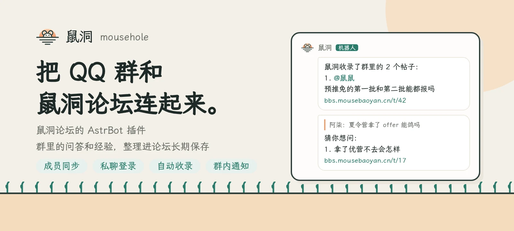
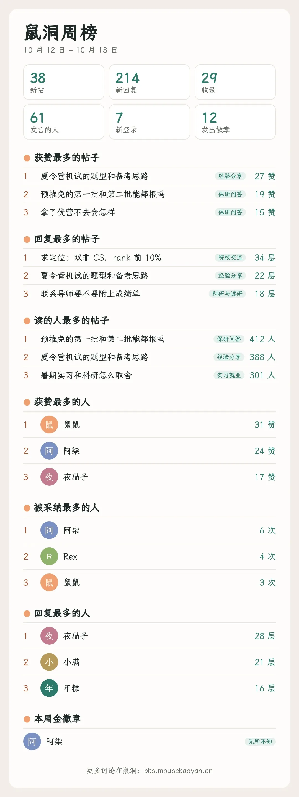
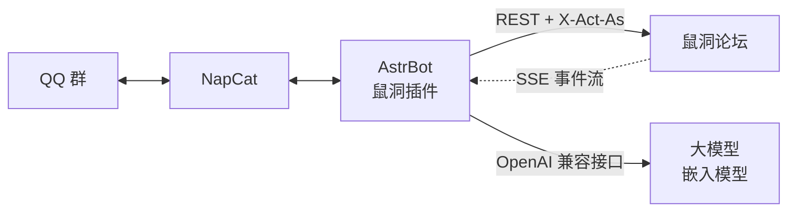

<div align="center">

<a href="https://bbs.mousebaoyan.cn"></a>

**把 QQ 群和鼠洞论坛连起来**

[鼠洞](https://github.com/mousebaoyan/mousehole)的 [AstrBot](https://github.com/AstrBotDevs/AstrBot) 插件：同步群成员，私聊登录，自动收录群里的问答，把开奖结果和周榜发到群里。

[](https://github.com/mousebaoyan/astrbot_plugin_mousehole/actions/workflows/ci.yml)
[](LICENSE)
[](pyproject.toml)
[](https://github.com/AstrBotDevs/AstrBot)

[访问鼠洞](https://bbs.mousebaoyan.cn) · [鼠群官网](https://mousebaoyan.cn/) · [鼠洞源码](https://github.com/mousebaoyan/mousehole) · [设计文档](docs/design.md)

</div>

## 简介

鼠群的 QQ 群里，有价值的提问和经验容易被后续消息淹没。鼠洞把它们整理成论坛帖子长期保存，这个插件负责让论坛和群互通。

- **账号与群同步**：群成员同步到论坛，进退群、管理员、群名片和头衔的变动随时跟进；成员私聊 bot 发「登录」，就能登录论坛。
- **沉淀群聊内容**：群里和保研、学业有关的提问和有信息量的讨论，连同群友的回复，在讨论停下来后由大模型整理成论坛的帖子和回复，分好版块和标签，记在本人名下。
- **论坛的动态回到群里**：开奖结果、周榜、金徽章、新回答提醒、悬赏、新投票，以及群里有人提问时论坛上已有的相关帖子。
- **尽量不打扰**：bot 只被动接收消息，只读 NapCat 的缓存，不主动私聊，主动发到群里的消息每一种都有频率上限，见[防风控](#防风控)。

## 群里的样子

bot 发到群里的话大多是下面这样的几行字，都可以在配置里改（示例是编的）：

```text
鼠洞收录了群里的 2 个帖子：
1. @鼠鼠
预推免的第一批和第二批能都报吗
https://bbs.mousebaoyan.cn/t/42
2. @夜猫子
（讨论）夏令营机试的题型
https://bbs.mousebaoyan.cn/t/43
```

```text
[引用：预推免第一批和第二批能都报吗]
@鼠鼠 你问的「预推免第一批和第二批能都报吗」在鼠洞上有 2 条新回答：
https://bbs.mousebaoyan.cn/t/42?floor=5
```

```text
【抽奖开奖】鼠群周年抽奖
一等奖：机械键盘 @鼠鼠
二等奖：鼠群周边 @阿柒 @夜猫子 @Rex
共 25 人参与
https://bbs.mousebaoyan.cn/t/42
```

每周日 20 点，周榜排成一张图片，传进群相册：

<p align="center">
  
</p>

<p align="center"><sub>图片由插件渲染，使用的是演示数据。</sub></p>

## 功能

| 类别 | 内容 |
| --- | --- |
| **成员同步** | 每小时同步完整的成员名单和群资料，进退群、管理员、群名片和专属头衔的变动按 QQ 通知增量推送；成员第一次登录时推送 QQ 个性签名 |
| **私聊登录** | 私聊 bot 发「登录」得到 10 分钟内有效的一次性登录链接，发网页上的 6 位口令确认网页登录；群里 @bot 说登录，只回「登录请私聊我」 |
| **自动收录** | 讨论停下来后分段交给大模型，整理成帖子和回复，后来的补充更新进原来那一层，群友撤回的消息不收；一个问题只开一个帖子，开新帖前先用嵌入模型查重；每天上午 9 点在群里发一条收录汇总，@ 发帖的人 |
| **历史收录** | 把早先导出的群聊记录，按和插件同样的规则收录到论坛，多个 worker 并行，中途停了可以接着收 |
| **猜你想问** | 群里有人提问、论坛上已经有帖子回答过时，引用他的消息，把帖子推给他 |
| **群里的提醒** | 开奖结果，每周日的周榜，金徽章的祝贺，提问在论坛上有了新回答时告诉楼主，每天晚上列出没人回答的悬赏问题和新开的投票 |
| **入群欢迎、链接卡片** | 有人进群时欢迎；群友发了帖子的链接，补一张写着标题和回复数的卡片 |
| **AI 总结** | 给论坛上回复多的帖子写总结，论坛决定写哪些，插件取内容、调大模型再推回去；在论坛后台打开后才开始写 |

各项功能的详细设计见[设计](docs/design.md)，自动收录的细节见[设计第 8 节](docs/design.md#8-自动收录)。

## 防风控

QQ 号被识别成机器人，整个群的服务就断了，所以插件让 bot 的操作和真人尽量没有区别：

- 群消息和通知只被动接收；读成员名单和群资料只读 NapCat 的缓存，不带 `no_cache`。
- 不主动私聊，不加好友；私聊只回复本人发来的消息。
- 回复前随机等 1–2 秒；主动发的消息排队发出，间隔 3–6 秒随机，每一种都有频率上限，发出的消息尽量不带链接。
- 新功能要让 bot 多调一个 QQ 接口或多发一种消息的，先和维护者商量。

接口和频率的完整清单见[设计第 2 节](docs/design.md#2-防风控)。

## 架构



论坛是唯一的数据源，插件几乎不存东西。插件主动连接论坛，所在的机器能访问外网就行，论坛不需要反向连接插件。详见[设计第 5 节](docs/design.md#5-结构)。

## 安装

需要 AstrBot 4.26.2 以上、5.0 以下，通过 aiocqhttp 接入 NapCat（按 NapCat 4.18 核对），Python 3.12 以上。

1. 在鼠洞后台的 bot 页创建 token，bot 的 QQ 号填机器人自己的，范围选 `read`、`act`、`sync`、`auth`、`events`，要自动收录再加 `moderate`（建标签）；在后台关联要同步的群。
2. 在 AstrBot 的插件页通过仓库地址安装，或者把这个仓库放进 `data/plugins/`，在插件配置里填论坛地址和 token。成员同步、私聊登录、个性签名、开奖结果、周榜、新回答提醒、悬赏、新投票、入群欢迎和链接卡片默认都开着，可以分别关掉。
3. 自动收录默认关着。先在插件配置里填好大模型（默认 ECNU 的 `ecnu-plus`）和嵌入模型（`bge-m3`）的地址和密钥，用[回放](docs/replay.md)调好，再打开「自动收录」。AI 总结的大模型在「AI 总结」里单独填，在鼠洞后台的站点页打开后才开始写。
4. 要发周榜的话，在 AstrBot 用的 Python 环境里运行 `python -m playwright install chromium`，周榜用 Chromium 排版成图片。不发周榜的不用装。

本机时间要准：论坛拒收比服务器时间晚 10 分钟以上的同步数据。AstrBot 开了会话白名单的，要放行已同步的群。

## 配置

同步哪些群在论坛后台关联，插件不另外配。常用的配置：

| 配置 | 默认 | 说明 |
| --- | --- | --- |
| `forum_url`、`token` | 鼠洞的地址、空 | 论坛地址和 bot token；token 为空时插件什么都不做 |
| `sync_members`、`login`、`push_bio` | 开 | 成员同步、私聊登录、推送 QQ 个性签名 |
| `lottery`、`weekly`、`badges`、`bounty`、`polls` | 开 | 开奖结果、周榜、金徽章、悬赏、新投票发到群里；`groups` 空的，开奖结果发到主群，其余发到论坛关联的所有群 |
| `answers`、`welcome`、`cards` | 开 | 新回答提醒、入群欢迎、链接卡片；`welcome.groups` 空的是论坛关联的所有群 |
| `archive.enabled` | 关 | 自动收录；`archive.notify` 控制要不要在群里发收录汇总 |
| `llm`、`embedding` | ECNU、本机 Ollama | 收录和猜你想问用的大模型（猜你想问还用 `llm.rerank_model` 给候选打分）和嵌入模型，OpenAI 兼容接口；`llm.tokens_per_day` 限制每天用的 token |
| `summary` | 开 | AI 总结，用自己的大模型和每天的 token 上限 |

bot 发的话都有模板，在配置里改。全部配置项和话术模板见[设计第 4 节](docs/design.md#4-配置)和[第 9 节](docs/design.md#9-通知)。

## 本地开发

用 [uv](https://docs.astral.sh/uv/) 管理 Python 环境和依赖。

```sh
uv sync                       # 装好开发环境
uv run pytest                 # 测试
uv run ruff check .           # lint
uv run ruff format .          # 格式化
```

测试用假的论坛、大模型和 NapCat 事件，不连真的服务。自动收录的效果用[回放](docs/replay.md)评：`uv run python -m tools.replay …` 拿历史群消息离线跑一遍。提交前请跑完测试和 ruff，其他命令和约定见 [AGENTS.md](AGENTS.md#命令)。

## 文档

| 文档 | 内容 |
| --- | --- |
| [设计](docs/design.md) | 目标、防风控、运行环境、配置、结构，成员同步、登录、自动收录、通知、事件流，测试 |
| [回放实验](docs/replay.md) | 用历史群消息调自动收录的分段大小、提示词、版块和查重的门槛 |
| [AGENTS.md](AGENTS.md) | 开发规范：文档索引、命令、代码和测试要求、提交约定，适用于开发者和编码 agent |
| 论坛的[接口](https://github.com/mousebaoyan/mousehole/blob/main/docs/api.md) | 请求、错误码、成员同步和事件流，以它为准 |

## 相关项目

- [鼠洞](https://github.com/mousebaoyan/mousehole)：四非计算机保研鼠群的论坛，本插件连接的对象
- [鼠群官网](https://mousebaoyan.cn/)（[源码](https://github.com/mousebaoyan/mousebaoyan.github.io)）

## 许可证

[MIT](LICENSE)。周榜用的霞鹜文楷屏幕阅读版字体遵循 [SIL OFL](mousehole/poster/OFL.txt)。
